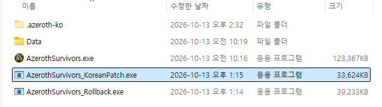
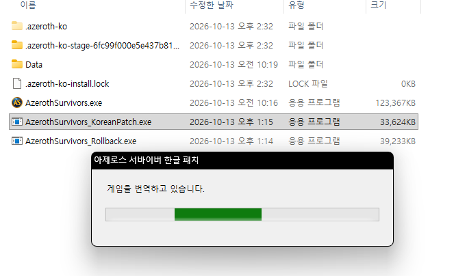
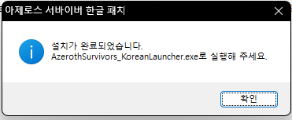

# Azeroth Survivors 한국어 패치

[다운로드](https://github.com/uckdoman/azeroth-survivors-korean/releases/latest/download/AzerothSurvivors_KoreanPatch.exe)

## 설치

1. 게임을 종료하세요.
2. 내려받은 패치 파일을 `AzerothSurvivors.exe`가 있는 폴더에 넣고 실행하세요.

   

3. 게임을 번역하는데 몇 분 정도 소요가 될 수 있습니다.

   

4. 설치가 완료되면 `AzerothSurvivors_KoreanLauncher.exe`로 게임을 실행하세요.

   기존 `AzerothSurvivors.exe`로도 실행할 수 있지만, 한글 실행기를 사용하면 새 한글 패치를 자동으로 확인하고 업데이트합니다.

   

## 롤백

한글 패치에 문제가 있을 때 원본으로 되돌리는 데 사용합니다.

[롤백 다운로드](https://github.com/uckdoman/azeroth-survivors-korean/releases/latest/download/AzerothSurvivors_Rollback.exe)

게임을 종료한 뒤, 내려받은 파일을 `AzerothSurvivors.exe`가 있는 폴더에 넣고 실행하세요.
